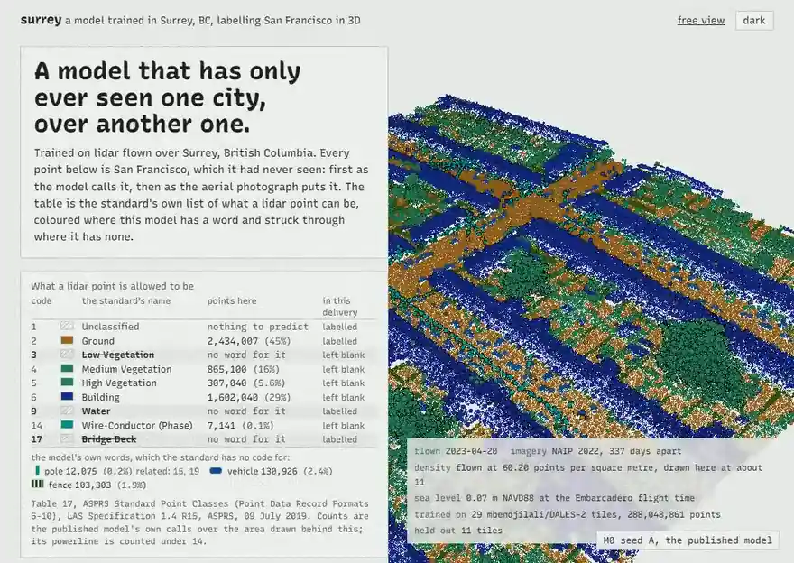
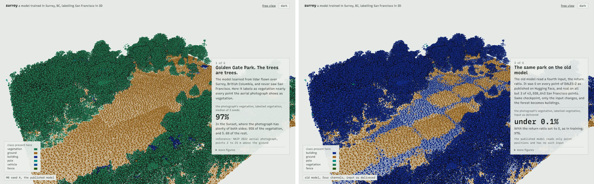
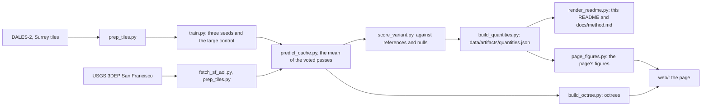

# surrey

A point cloud model trained on labelled lidar from Surrey, British Columbia, then run on San Francisco, where nothing is labelled.
The page with the real points in 3D: **[markolivaic.github.io/surrey](https://markolivaic.github.io/surrey/)**

[](https://github.com/markolivaic/surrey/actions/workflows/ci.yml)

On Surrey tiles held out of training, the model reaches a mean IoU of 0.52 over the 15 DALES-2 classes, between the 0.42 and 0.69 that the dataset's authors report for KPConv and PTv3 under a protocol that differs. In San Francisco, a city it was never trained on, ground and vegetation transfer well, and buildings transfer but score far lower among the Financial District's towers. Water and bridge decks fail, because the training labels have no word for either: 95% of the water at Embarcadero is labelled ground.

None of this is ground truth. San Francisco has no hand labels, so every figure there is measured against a reference with errors of its own, and the city also served as the development set.

[](docs/walkthrough/app-walkthrough.mp4)

The colours are the model's predictions. The recording links to the [MP4](docs/walkthrough/app-walkthrough.mp4); its first frame is the [poster](docs/walkthrough/app-walkthrough-poster.jpg).

## How San Francisco is scored without labels

The San Francisco lidar is the USGS 3DEP delivery: the points as a vendor handed them over, with the vendor's automatic classes. Each class is scored against something the model never saw:

- **Ground** against the delivery's ground class. Precision is a band, because the delivery leaves many points unassigned: its floor counts only the delivery's ground as right, its ceiling also counts unassigned points on the delivery's ground surface.
- **Buildings** against Microsoft's building footprints, as lift over a null, a rule that never looks at the model: here, every point more than 2 m up is a building. Lift is (p - p0) / (1 - p0) for the model's precision p and the null's p0, so 0 is no better than the null and 1 is every point right.
- **Vegetation** against cores from NAIP, the 2022 aerial photograph, through its near infrared band. A core is a point 2-25 m above the ground well inside a patch the photograph shows as vegetation, or as not vegetation.
- **Water and bridge decks** against the delivery's own classes for them.

Every model figure is the median of three training seeds, with the lowest and highest in brackets. A figure counts as moved only when every seed of one model lies beyond every seed of the other, which chance alone does with probability 0.10, so no single comparison here is significant on its own ([docs/method.md](docs/method.md)).

## Three models

| Model | What it is | Read against |
|---|---|---|
| Published model (fp32 search) | A PointNet++ style network reading point positions only, trained on DALES-2. Seed A is the published checkpoint; seeds B and C repeat the recipe for the spread | its nulls and rules |
| fp16-search model | The same recipe trained before a fault in its neighbour search was fixed | the published model |
| Return-ratio model | An older model that also read the return ratio | itself, with that input set to 0 |

In the code the published recipe is M0. Two older models, M0prime and M1, appear only under water.

## At home in Surrey

On the 11 held-out Surrey tiles the published recipe reaches, over its three seeds, a mean IoU of 0.52 (0.52 to 0.53) over the 15 classes, and a point accuracy of 93% against 48% for calling every point ground. IoU, intersection over union, is for each class the points both the model and the label give it, over the points either gives it. Rare classes such as heavy vehicles and poles pull the mean down ([per class](docs/method.md)). The DALES-2 paper reports 0.29 for RandLA-Net, 0.42 for KPConv and 0.69 for PTv3 on the same classes and tiles, without saying which inputs or subsampling its models used; here the score is from geometry alone, over thinned points after voting. The held-out tiles also served for validation: they were scored during training, and the number of voting passes was chosen on them.

## San Francisco, class by class

Each class beside the figure that catches the opposite mistake:

| Area | NAIP vegetation cores called vegetation | NAIP not-vegetation cores called vegetation | Delivery ground called ground | Ground precision, floor | Ground precision, ceiling |
|---|---|---|---|---|---|
| Golden Gate Park | 0.97 (0.97 to 0.98) | 0.94 (0.93 to 0.95) † | 0.97 (0.93 to 0.98) | 0.75 (0.74 to 0.75) | 0.97 |
| Sunset | 0.95 (0.94 to 0.95) | 0.056 (0.054 to 0.056) | 0.97 (0.96 to 0.98) | 0.74 (0.74 to 0.75) | 0.96 |
| Mission | 0.98 (0.98 to 0.99) | 0.047 (0.046 to 0.050) | 0.98 (0.94 to 0.99) | 0.71 (0.68 to 0.72) | 0.87 (0.84 to 0.89) |
| Russian Hill | 0.93 (0.92 to 0.94) | 0.065 (0.064 to 0.074) | 0.92 (0.90 to 0.94) | 0.77 (0.75 to 0.77) | 0.95 (0.92 to 0.95) |
| SoMa | 0.99 | 0.028 (0.028 to 0.035) | 0.99 (0.98 to 1.00) | 0.69 (0.67 to 0.71) | 0.84 (0.81 to 0.86) |
| Financial District | 1.00 | 0.12 (0.12 to 0.13) | 0.99 (0.97 to 0.99) | 0.62 (0.59 to 0.63) | 0.86 (0.81 to 0.87) |
| Embarcadero | 1.00 | 0.059 (0.053 to 0.066) | 0.84 (0.80 to 0.86) | 0.17 | 0.27 (0.26 to 0.28) |
| Bay Bridge | no core | 0.042 (0.031 to 0.051) | no core | no core | no core |

† The park's not-vegetation cores are few and return like canopy, so that figure is not read as a test of the model ([docs/method.md](docs/method.md)).

In the Sunset, where the photograph has plenty of both sides, the model labels 95% of the vegetation cores vegetation and 5.6% of the rest. A rule calling every point 2-25 m up vegetation scores 100% on both, by construction; a rule calling every point within half a metre of the floor ground finds 72% of the Sunset's ground, against the model's 97%.

Buildings, where the null calls something a building. The interval is a bootstrap over footprints for seed A; the rule calls a building every point more than 2 m above the delivery's ground where NAIP is not green:

| Area | Footprints scored | Offset measured here | Building lift | Precision against footprints | The null's precision | Footprint covered | The null's coverage | Lift, seed A, 95% interval | The rule's lift |
|---|---|---|---|---|---|---|---|---|---|
| Sunset | 33 | yes | 0.67 | 0.85 | 0.54 | 0.99 | 0.99 | 0.62 to 0.72 | 0.45 |
| Mission | 56 | yes | 0.61 | 0.83 | 0.56 | 0.97 (0.97 to 0.98) | 0.99 | 0.54 to 0.66 | 0.42 |
| Russian Hill | 77 | yes | 0.55 (0.55 to 0.57) | 0.83 (0.83 to 0.84) | 0.62 | 0.98 | 0.99 | 0.53 to 0.61 | 0.37 |
| SoMa | 26 | no | 0.56 (0.55 to 0.56) | 0.85 (0.84 to 0.85) | 0.65 | 0.72 (0.72 to 0.73) | 0.75 | 0.42 to 0.68 | 0.42 |
| Financial District | 23 | no | 0.22 (0.20 to 0.22) | 0.75 (0.74 to 0.75) | 0.68 | 0.83 (0.81 to 0.83) | 0.85 | 0.11 to 0.30 | 0.063 |
| Embarcadero | 6 | no | 0.13 (0.12 to 0.14) | 0.31 (0.30 to 0.31) | 0.20 | 0.85 (0.84 to 0.86) | 0.87 | 0.064 to 0.59 | 0.19 |

The model's lift beats the rule's everywhere but Embarcadero, which has 6 footprints to score. Water and bridge decks are where it fails: at Embarcadero 95% (92% to 99%) of the water is labelled ground, and on the Bay Bridge 36% (24% to 52%) of the deck building.

## The towers and a half-precision search

The neighbour search used to compute squared distances in half precision, which got coarser the higher a point stood above its 40 m block's floor: on the tallest Financial District blocks the fp16-search model matched an exact search on 13% of the points more than 100 m up. The search now runs in full precision, and the model was trained again with nothing else changed. Of the district's points more than 150 m up, the fp16-search model labelled 95% pole; the published model, seed A, labels 77% building and 12% ground. On the Bay Bridge it labels 34% of the points more than 60 m up ground.

Of 69 figures compared between the two searches, 9 moved, where chance alone would move about 6.9. The two largest are bridge decks labelled building, from 100% to 36% on the Bay Bridge and from 100% to 24% at Embarcadero. The fix changed tall and raised structures most ([all moves](docs/method.md)).

## The Financial District

Its median 40 m block spans 99.8 m of height, against 46.2 m for the 99th percentile of training blocks. A claim written before the first training said buildings would score lower here than in Embarcadero, Mission, SoMa and Sunset, and they do on 3 of 3 seeds: lift 0.22 (0.20 to 0.22) against a median of 0.58, with precision 75% against 85% in the Sunset.

That is consistent with the district's heights, not shown to be caused by them. Its blocks taller than any training block score about the same as its other blocks (0.21 against 0.23), and its blocks spanning less than 15 m score 0.35 for seed A, against 0.56 elsewhere. Its footprints, drawn by a model from imagery of uncertain date, could not be registered to the lidar, so they take the offset measured in 3 other areas.

## Claims written before training

A claim stands only if it holds on all three seeds. The scoring was revised once with results in hand: eight scoring rules were changed after the earlier models' figures on the same San Francisco data had been seen, and fixed before the retrained models were scored (`docs/criteria/neighbour_search.md`).

| Claim | Holds on | Stands | Changed afterwards |
|---|---|---|---|
| Buildings score lower in the Financial District, the one area taller than training, than the median of Embarcadero, Mission, SoMa and Sunset: lift lower by at least 0.05 | 3 of 3 seeds | yes | no |
| On Russian Hill, delivery ground in steep 40 m blocks is called building more often than in the rest, by at least 0.05 | 2 of 3 seeds | no | the primary metric was changed after the first run, to the one the earliest written prediction named |
| On water at Embarcadero, confidence separates wrong ground calls from right ones less well than near-ground mistakes at home, by at least 0.05 AUROC | 3 of 3 seeds | yes | the two references differ: delivery water against human labels at home |
| Inside the Financial District, blocks taller than any training block score lower than the district's other blocks, lift lower by at least 0.05 | 0 of 3 seeds | no | an addition, written after the claim above and not before training |

## The return ratio fault



The return-ratio model read a fourth input: a point's return number divided by the number of returns its laser pulse produced. DALES-2 as published on Hugging Face holds 0 in its return fields, so that input was 0 on all 395,996,290 prepared training points, and real on all but 3 of 43,938,643 San Francisco points. With the input as delivered the model labelled under 0.1% of Golden Gate Park's vegetation cores vegetation; the same checkpoint with it set to 0 labels 97%. The published model reads point positions only, and `tests/integrity/test_input_channels.py` fails on any input that `scripts/pipeline/input_channel_check.py` recorded as constant in training or out of range in San Francisco.

## Water

The old M1 learned water from Swiss tiles where 86% to 100% of the labelled water is synthetic: where a lake sends no pulse back, the survey fills it with points on a 25 cm grid. On an unseen Swiss tile, mostly fill, its water IoU is 0.93; at Embarcadero it finds 0.2% of the water, and it beats the water null on 0 of 3 seeds there and 0 of 3 at Bay Bridge. With that little real water to learn from, it is not trained again ([docs/method.md](docs/method.md)).

## Why this exists

Most lidar segmentation results are reported on tiles from the same survey the model learned from. That tells you how well it learned one place. It does not tell you what happens when the same model is pointed at a city it was never trained on, which is what anyone who wants to use it will do.

I wanted to see that gap on real data, not on a benchmark split. Surrey is where the labels are; San Francisco has a public national lidar delivery and no labels at all. So the question became how to measure a model where nothing is labelled, without fooling myself. Each class is scored against something the model never touched: the delivery's own ground class, building footprints, vegetation from aerial imagery. Each figure stands beside a null or a simple rule. The claims were written before the numbers, and the table above marks the ones changed or added afterwards.

This would be wrong if the references are wrong, and they are imperfect: the footprints sit off the lidar, the vegetation mask is a colour index, and San Francisco is also where the input fault was found. Those limits are listed below.

## From public data to this page



Every figure in this README is a key in `data/artifacts/quantities.json`, built from the committed artefacts; `python scripts/pipeline.py` lists every step that writes them. The model and metrics are in `backend/surrey/`, the steps in `scripts/pipeline/`, one-off measurements in `archive/investigations/`, the page in `web/`. The octrees the page streams are at [huggingface.co/datasets/Maki101/surrey-viewer](https://huggingface.co/datasets/Maki101/surrey-viewer), the weights at [huggingface.co/Maki101/surrey](https://huggingface.co/Maki101/surrey).

## Quick start

A fresh clone runs the tests and shows the page on a synthetic test octree, marked FIXTURE, with no key or account. It needs Python 3.12 and Node 24, the version CI uses.

```bash
python -m venv .venv
source .venv/bin/activate        # Git Bash: source .venv/Scripts/activate   cmd: .venv\Scripts\activate
python -m pip install -r requirements.txt
python -m pytest tests/unit tests/integrity -q
cd web
npm ci
npm test
npm run build
cd ..
python -m playwright install chromium     # about 150 MB; on Linux add --with-deps
python -m pytest tests/smoke -q
python scripts/pipeline/serve_page.py
```

`requirements.txt` points pip at PyTorch's CPU index for torch 2.9.1+cpu; installed any other way, torch pulls the CUDA build and gigabytes of NVIDIA libraries with it. The models were trained with torch 2.11 on NVIDIA cards. `serve_page.py` prints the fixture page and the real page, which needs the octrees the pipeline builds.

```bash
python scripts/pipeline.py              # the steps, with what each reads and writes
python scripts/pipeline.py --check      # which outputs are already on disk
python scripts/pipeline.py --run all    # all of it, in order; hours, and an NVIDIA card
```

PotreeConverter 2.1.3 and ffmpeg are looked for on PATH, or named in `.env.example`. `python scripts/pipeline/record_walkthrough.py` makes the walkthrough from the built page and the octrees; it needs ffmpeg and Playwright's Chromium.

## Checking the numbers

Each row is a command run from the repository root, with what `scripts/pipeline/verify.py` printed on Windows 11, AMD64 Family 25 Model 68 Stepping 1, AuthenticAMD, NVIDIA GeForce RTX 3050 Laptop GPU, Python 3.12.1, on 2026-11-05. A parametrised test counts once. In a fresh clone two integrity tests skip for want of the octrees and prepared tiles, which the pipeline builds, and the CUDA neighbour search test skips without a card.

| Check | Command | Result |
|---|---|---|
| behavioural tests | `python -m pytest tests/unit -q` | 173 tests; cases 181 passed, 1 skipped |
| integrity tests | `python -m pytest tests/integrity -q` | 15 tests; cases 18 passed |
| README is generated | `python scripts/pipeline/render_readme.py --check` | passes |
| page figures | `python scripts/pipeline/page_figures.py` | passes |
| viewer tests | `npm test (in web/)` | 11 passed, 0 failed |
| viewer build | `npm run build (in web/)` | passes |
| page smoke test | `python -m pytest tests/smoke -q` | 2 tests; cases 2 passed |

## What could make this wrong

- San Francisco was the development set as well as the test.
- The footprints were registered to the lidar in 3 of the 6 areas with footprints, and the rest take their offset. Embarcadero's building figures rest on 6 footprints, the Financial District's on 23.
- NAIP was flown 337 days before the lidar; the method notes show how the vegetation figures move with its threshold.
- Neighbouring points are not independent, and the seed range is not a confidence interval. The building bootstrap is the only interval given.
- The return-ratio model, M0prime and M1 carry the old half-precision search, and each is read only against itself or its pair.

## Papers

These motivate the design; they do not validate the numbers here.

- Varney, N., Asari, V. K., Graehling, Q. DALES: A Large-Scale Aerial LiDAR Data Set for Semantic Segmentation. CVPR Workshops, 2020. arXiv 2004.11985.
- Singer, N. M., Asari, V. K. DALES Objects: A Large Scale Benchmark Dataset for Instance Segmentation in Aerial Lidar. IEEE Access 9, 97495-97504, 2021. doi:10.1109/ACCESS.2021.3094127.
- Bendjilali, M., Peyran, C., Velumani, K., Mauri, A., Luminari, N., Alliez, P. DALES 2: A Renovated Aerial LiDAR Benchmark for 3D Scene Understanding. CVPR Workshops (USM3D), 2026. Data at huggingface.co/datasets/mbendjilali/DALES-2.
- Xie, Y., Schindler, K., Tian, J., Zhu, X. X. Exploring Cross-City Semantic Segmentation of ALS Point Clouds. ISPRS Archives XLIII-B2-2021, 247-254, 2021. Cross-city loss in aerial lidar is known; this measures one case.
- Wang, P., Yao, W., Shao, J., He, Z. Test-time adaptation for geospatial point cloud semantic segmentation with distinct domain shifts. arXiv 2407.06043, 2024. DALES has been a source domain before.
- Hendrycks, D., Gimpel, K. A Baseline for Detecting Misclassified and Out-of-Distribution Examples in Neural Networks. ICLR, 2017.
- Qi, C. R., Yi, L., Su, H., Guibas, L. J. PointNet++: Deep Hierarchical Feature Learning on Point Sets in a Metric Space. NeurIPS, 2017.
- ASPRS. LAS Specification 1.4 R15, 09 July 2019, Table 17, ASPRS Standard Point Classes.
- Boucheny, C. Visualisation scientifique de grands volumes de données : pour une approche perceptive. PhD thesis, Université Joseph Fourier, Grenoble, 2009. HAL tel-00438464. The source of eye-dome lighting.

## License

Code: MIT, in LICENSE. Model weights and predictions: CC BY-NC 4.0, in LICENSE_MODEL.md, because the labels' upstream DALES layer carries a non-commercial restriction. Data, the quoted class table and model inputs carry their own terms, in THIRD_PARTY_NOTICES.md.
