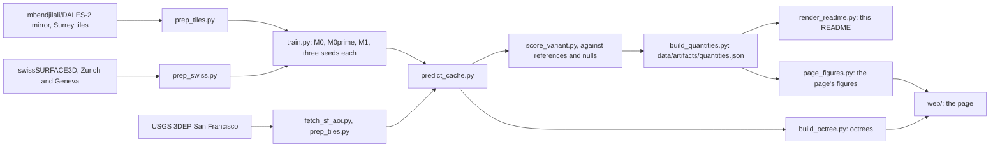

# surrey

A point cloud segmentation model that has only ever seen one city, run on another.

[](https://github.com/markolivaic/surrey/actions/workflows/ci.yml)

It is named after Surrey, British Columbia, where the lidar it learned from was flown, and every picture in it is San Francisco, where it was asked to work. That gap is the project: what a model carries across a city it has never seen, measured against what San Francisco can actually check. The labels come from DALES, which is named after the University of Dayton, where the annotating was done, and was not flown over Dayton either.

> The walkthrough is recorded after the repository's first CI run on GitHub, and is the one part of this README still to come.

## What this is

- A PointNet++ style network trained on the Hugging Face mirror mbendjilali/DALES-2: lidar flown over Surrey, British Columbia, Canada, labelled in fifteen classes. Not flown over Dayton; the University of Dayton did the annotating.
- The published model, M0 seed A, run on eight areas of the USGS 3DEP San Francisco delivery, and scored per area against references that owe nothing to the model: the delivery's own ground class, building footprints beside their null, and vegetation from NAIP imagery.
- Three training seeds, and every claim read on each of them.
- A static web page that streams the real points and lets you move a divider between the photograph and the model's classes.

## What this is NOT

- **Not ground truth.** The colours on San Francisco are predictions from a model trained in another country. They are not measurements and not part of any USGS deliverable.
- **Not a labelled benchmark in San Francisco.** None is published for this delivery. Ground is scored against a vendor's automated class, buildings against 2D footprints of uncertain age, vegetation against an NDVI mask.
- **Not a model that knows water or bridges.** The training labels have no word for either, so the bay is called ground and the Bay Bridge deck is called a building.
- **Not a statement about DALES.** The zeros in the return fields described below are in the mirror mbendjilali/DALES-2. The original DALES could not be checked without registration.
- **Not the full page from a fresh clone.** The real point clouds are built by the pipeline below and are not in the repository. A clone shows the page on a synthetic FIXTURE octree, labelled FIXTURE on screen: random points and random confidences, for the smoke test and the quick start, not data and not predictions.
- **Not new.** Models trained in one city being overconfident in another is well known. What is here is a careful measurement of it, and a page that lets you see it.

## Walkthrough

Recorded after the repository's first CI run on GitHub. Until then there is no media here.

## How it works



| Path | What it holds |
|---|---|
| `backend/surrey/` | The model, the block cache, inference, the metrics, the palette and its rules, the registry of every quantity (`quantities.py`) |
| `scripts/pipeline.py` | Every step from the public sources to this README and the page, in order, with what each reads and writes |
| `scripts/pipeline/` | The steps themselves |
| `scripts/investigations/` | Measurements that each answered one question; their artefacts are committed and some figures here come from them |
| `data/artifacts/` | The committed artefacts every figure here is read from, `quantities.json` the registry over all of them |
| `docs/readme.template.md` | This README with each figure named by registry key; `scripts/pipeline/render_readme.py` fills it in |
| `web/` | The page: its own three.js loader for Potree 2 octrees, the eye-dome pass, the cards, the free view |
| `web/fixtures/FIXTURE/` | The synthetic octree a fresh clone and the smoke test draw |
| `tests/unit/` | Behavioural tests of the code |
| `tests/integrity/` | Guards over the documents, the artefacts, the page and the registry, counted apart |
| `tests/smoke/` | The built page opened in a real browser on the FIXTURE octree |
| `docs/design/` | The design rules, the palette, and the frames the colour vision test reads |
| `docs/phase4_criteria.md` | What the next round of training runs and how it is read, written before it runs |
| `data/artifacts/logs/` | The GPU chain logs: when each rule was written against when each run finished |

## What it does in San Francisco

In domain first, on every voxel-thinned held-out Surrey point: point accuracy 0.9159 over three seeds (0.9179 to 0.918), against a do-nothing baseline of 0.4797 for calling everything ground on the same thinned set.

San Francisco, median over three seeds with the lowest and highest seed beside it:

| Area | Building lift over the footprint null | NAIP vegetation cores called vegetation | Delivery ground called ground |
|---|---|---|---|
| Golden Gate Park | no buildings | 0.9722 (0.9704 to 0.9724) | 0.9425 (0.9366 to 0.9779) |
| Sunset | 0.6699 (0.6634 to 0.6765) | 0.9465 (0.9418 to 0.9471) | 0.9647 (0.9588 to 0.9744) |
| Mission | 0.6136 (0.6023 to 0.6151) | 0.9828 (0.9803 to 0.9837) | 0.9692 (0.9582 to 0.9872) |
| Russian Hill | 0.5579 (0.5531 to 0.5623) | 0.9313 (0.9201 to 0.9318) | 0.9139 (0.9028 to 0.9354) |
| SoMa | 0.5621 (0.5594 to 0.5631) | 0.9854 (0.9834 to 0.9862) | 0.9922 (0.9828 to 0.9958) |
| Financial District | 0.1456 (0.1452 to 0.1972) | 0.9969 (0.9962 to 0.997) | 0.9784 (0.9726 to 0.9861) |
| Embarcadero | 0.0443 (0.0382 to 0.0499) | 0.9985 (0.9985 to 0.9987) | 0.8318 (0.8095 to 0.8722) |

Building lift is the share of the room above the null the model takes, where the null calls every point over 2 m a building. The vegetation column takes the lower of two NAIP masks, one registered to the lidar and one not, because a rule fixed before the numbers could not choose between them.

Trees stay trees across the city. Buildings are found in the Sunset, the Mission, SoMa and on Russian Hill, and poorly among the towers of the Financial District, where blocks are taller than anything in the training data: that confound predicts the drop on all 3 seeds. At Embarcadero the lift is near zero, and most of what stands above 2 m there is the bridge and the piers. The one written for steep ground, hillsides called buildings on Russian Hill, predicts it on 2 of 3 seeds.

## The input that broke the first model

The first model read a fourth input, the return ratio. It was 0 on every one of the 395,996,290 prepared training points, because the mirror's return fields are empty, and real on all but 3 of 44,129,084 San Francisco points. Fed as delivered, that input had never been seen, and the forest became buildings. The same checkpoint with the return ratio set to 0, nothing else changed:

| Area | NAIP vegetation cores called vegetation, input as delivered | the same, return ratio set to 0 |
|---|---|---|
| Golden Gate Park | 0.0001 | 0.9393 |
| Sunset | 0.0 | 0.9408 |
| Mission | 0.0002 | 0.974 |
| SoMa | 0.0005 | 0.9452 |
| Russian Hill | 0.0048 | 0.9297 |
| Financial District | 0.0002 | 0.9894 |
| Embarcadero | 0.0281 | 0.9918 |

The published model has three inputs and no such state. `tests/integrity/test_input_channels.py` now fails any model with an input that is constant in training.

## Where it fails

**Water and bridge deck.** Water called ground: 0.9618 at Embarcadero (0.9089 to 0.9724) and 0.9713 at Bay Bridge (0.9284 to 0.9752). Bridge deck called building: 0.9983 at Bay Bridge (0.9982 to 0.9984). And its confidence gives those mistakes away less than it gives away mistakes at home. Among ground calls, confidence separates right ground from errors within half a metre of the surface at an AUROC of 0.9375 at home (0.9292 to 0.9407), and water from right ground in Embarcadero at only 0.7404 (0.7144 to 0.7506). Water errors are harder to see than errors at home on all 3 seeds.

**Roofs called ground.** Among points the delivery leaves unassigned more than 3 m above its ground, the share called ground is above the model's own range on the held-out Surrey tiles in Mission, SoMa and Embarcadero on all 3 seeds: transfer. In Golden Gate Park, the Sunset, Russian Hill and the Financial District it stays inside that range on all 3: a weakness the model has at home too.

## M1: teaching it water

M1 adds swissSURFACE3D tiles from Zurich and Geneva, where water and bridge decks are labelled, beside a control trained on the same data without those two classes (M0prime). The criterion was written before training. **M1 did not meet it.**

Lift over the water null, per seed, where the rule asked for a positive lift on all three seeds at both places:

| area | seed A | seed B | seed C | result |
|---|---|---|---|---|
| Embarcadero | -1.4314 | -1.4439 | -1.4478 | positive on 0 of 3 seeds |
| Bay Bridge | -1.4652 | -1.4655 | -1.4386 | positive on 0 of 3 seeds |

**The class was learned, and it does travel; it just does not reach San Francisco.** Scored on the sixteen Swiss sub-tiles it learned water from, M1 seed A reaches water IoU 0.959 (precision 0.9634, recall 0.9952) against a null that calls every point water and reaches 0.2577. Those sub-tiles are training tiles, so that figure alone cannot tell a learned class from sixteen memorised tiles. So a tile from a third city was taken afterwards, by the same rule, and never trained on: Zug, where the Lorze leaves the lake. Water IoU there is 0.8448, 0.9304 and 0.9386 on the three seeds, against a null of 0.2225, and the control that has no water output calls water on nothing. The class is real and it generalises inside Switzerland. In San Francisco the same model finds 0.007, 0.0019 and 0.0003 of the water at Embarcadero on the three seeds. Bridge deck is a different case and is not read as transfer at all: in-sample, on its own training
tiles, it reaches IoU 0.2583 against a null of 0.006, so the class was never learned at home, and what it
does at the Bay Bridge says nothing about carrying a class across the ocean.

**What changed is the density the model reads, and only for water.** Every crop is 32,768 points over a 40 m block whatever the source holds, so a source denser than that is thinned by the crop itself. Surrey arrives at 20.48 points per square metre and San Francisco at 20.48, the same number, from source densities of 38.04 and 49.86. The Swiss training tiles arrive at 11.55, because their blocks hold fewer points than a crop and the crop repeats them. So water was learned at about half the density it is asked to work at, while the fifteen DALES classes were learned and tested at the same density.

That is measurable in both directions. Asking the same M1 for water over San Francisco crops carrying the Swiss number of distinct points lifts water recall from 0.022 to 0.0818 at Embarcadero and from 0.0034 to 0.0194 at Bay Bridge, with ground recall as a control holding (0.7094 to 0.635). Sparser still and water keeps coming, 0.2041 and then 0.4756, but the control goes with it (0.1235) and those readings are not safe. And the held-out Zug tile, where water works, sits at 16.63 points per square metre, between the two.

**The grid under the Swiss water.** The points swisstopo labels water sit on a regular 25 cm grid: 0.952 of them on the training tiles and 0.745 on the Zug tile, against 0.0144 by chance, where the Swiss ground beside them sits at chance (0.0409 against 0.0389) and so does San Francisco's water (0.0748 against 0.0744); `scripts/investigations/water_lattice.py`. The prepared points are voxelised at 15 cm, which cannot make a 25 cm grid. Moving the Zug water points off the grid by up to 12 cm, and nothing else, takes M1 seed B's water IoU from 0.9304 to 0.2454, and leaves seed A at 0.8448 to 0.8435 and seed C at 0.9386 to 0.922; moving ground by the same amount instead leaves all three at or above where they were; `scripts/investigations/water_lattice_test.py`, with its reading written before it ran. One seed of three reads the grid; the other two do not, so the grid does not explain the San Francisco result either, and the rest of it is not explained.

Nothing of this touches the rest of the table. Running the published M0 over the same San Francisco blocks at the DALES density changes nothing at all, because the crop already equalises them: ground recall at Embarcadero reads 0.7864 as drawn and 0.8103 at the DALES density, vegetation 0.9958 against 0.9959, and the grouping reaches 0.778 m in Embarcadero against 0.788 m on the Surrey tiles the model trained on. The M0 figures in the table above are not held down by point spacing.

**What M1 does change.** Water called ground falls from M0prime's 0.9528 (0.8972 to 0.9641) to M1's 0.8502 (0.7909 to 0.9095) at Embarcadero, and from M0prime's 0.9395 (0.9384 to 0.9549) to M1's 0.8904 (0.7794 to 0.9327) at Bay Bridge. The ranges do not overlap, so it falls on every seed. Bridge deck called building barely moves at Embarcadero, from the control's 0.9997 (0.9982 to 0.9998) to 0.9997 (0.9987 to 0.9997). At Bay Bridge the control calls 0.9984 (0.9984 to 0.9985) of it building, and M1 calls 1.0, 0.9984 and 0.9307 on its three seeds: the drop belongs to one seed, not to the recipe.

**What it costs, on all three seeds.** Ground recall at Embarcadero falls from 0.8072 to 0.7961 under M0prime to 0.7953 to 0.7351 under M1, and the same drop shows in the Financial District, Mission, SoMa and the Sunset. Confidence separates easy errors less well at Embarcadero, Mission and SoMa. On the held-out Surrey tiles, ground, vegetation, annex and pickup all fall. Giving the model two more words cost it accuracy on the words it had.

**The interrupted seed.** M1 seed A was cut off by a power loss and resumed once from its checkpoint at step 5750, before the checkpoint saved random states, so its data order after that step differs from an unbroken run. It is not an outlier. Of the 56 side effect measurements, 54 have three distinct seed values, and for
three distinct values exactly two of them lie outside the range of the other two, so the counts have to
sum to 108: seed A sits outside 22 times, seed B 44 and seed C 42, against the 36 each that exchangeable
seeds would average. The interrupted seed is the least extreme of the three. The other 2 measurements are
the building lift at Bay Bridge and in Golden Gate Park, where all three seeds read zero because neither
area has footprints to score against, so no seed is outside anything there.

M1's water is judged against a water null: every point below the sea level measured by NOAA gauge 9414290 at the moment it was flown, plus half a metre, called water. The water null is not a do-nothing baseline: it knows each point's absolute height in NAVD88 and the sea level at the moment of flight. The model knows neither; it sees height above the floor of a 40 m block.

M1 seed A was cut off by a power loss and resumed once, from its checkpoint at step 5750. The code then did not save the random states, so the data order after step 5750 differs from an unbroken run; its training artefact records the interruption as not exact. Every training artefact records its interruptions the same way, as a count, or as unknown where no log proves one. If M1 seed A lands outside the range of seeds B and C, that is reported beside this note.

## Does a bigger model help

The published model has 725,967 parameters because the laptop it was
trained on has 4.29 GB, which is a reason about hardware and not about the problem. So a card was rented
and the same recipe was trained again beside a model sixteen times its size, on the same data and the
same number of points seen. The rule for adopting the larger model was written before any of it ran: its
building lift had to beat the three small seeds in at least 4 of the 6 areas that have footprints. It did
so in 1, so the larger model is reported here as a control and nothing else
in this repository changed. On the rented card, with the machine therefore cancelling out, the larger
model is not better in domain either, and it trades ground for buildings: its building lift is higher in
all six areas and its ground recall is lower in all six.

| model, both on the same rented card | parameters | in domain accuracy |
|---|---|---|
| the published configuration | 725,967 | 0.8976 |
| sixteen times larger | 11,505,423 | 0.9189 |

One caveat belongs with every figure in this section, and it was found by the control that exists to
find it: the same recipe trained on the rented card lands outside the three laptop seeds on
19 of 30 San Francisco
measures. Part of any difference between a large run and a small one is the machine, the driver and the
kernels, not the model. Three seeds on one laptop understate how much a figure can move.

## Quick start

A fresh clone has everything to run the tests and to see the page on the FIXTURE octree, and no key or
account is needed. It needs Python 3.12 and Node 24.

```bash
python -m venv .venv
# Windows: .venv\Scripts\activate      Linux and macOS: source .venv/bin/activate
python -m pip install -r requirements.txt
python -m pytest tests/unit tests/integrity -q
cd web
npm ci
npm run build
cd ..
python -m playwright install chromium
python -m pytest tests/smoke -q
python scripts/pipeline/serve_page.py
```

`requirements.txt` installs the CPU build of torch 2.9.1, so the tests run anywhere. Every model and
every figure here was trained and predicted with torch 2.11.0+cu128 on NVIDIA cards, an RTX 3050 laptop
and a rented RTX 4090, and each training artefact records its card and its torch version. The CUDA
build goes over the top with the command in `requirements.txt`.

`serve_page.py` prints two addresses. The fixture page, `index.html?fixture=1`, works from a fresh
clone and says FIXTURE on screen. The real page needs the octrees, which the pipeline below builds.

The full pipeline is `scripts/pipeline.py`: every step in order, each writing what a later one reads,
from the DALES-2, swisstopo and USGS downloads through the building footprints, the NAIP vegetation
reference, the water polygon and the physical water null, to training, prediction, scoring, the
registry, this README and the page. Downloading, training and prediction take hours and want an NVIDIA
card; the tests and the page do not.

```bash
python scripts/pipeline.py              # the steps, with what each reads and writes
python scripts/pipeline.py --check      # which outputs are already on disk
python scripts/pipeline.py --run all    # all of it, in order
```

Two tools are looked for on PATH and in the usual install folders, and can be named in `.env.example`
instead: PotreeConverter 2.1.3 for the octrees and ffmpeg for the walkthrough.

## Verification

Each row is a command a reader runs from the repository root. The results are what
`python scripts/pipeline/verify.py` printed in the working copy, on Windows 11, AMD64 Family 25 Model 68 Stepping 1, AuthenticAMD, NVIDIA GeForce RTX 3050 Laptop GPU, Python 3.12.1, on
2026-09-26. A test is counted once however many cases a parametrisation makes of it; the
cases are given after it.

Before this repository's first commit, the order in which rules were written and results appeared rests
on the chain logs in `data/artifacts/logs/` and the dates the project wrote into its own artefacts. From
the first commit on, the git history shows it.

| Check | Command | Result |
|---|---|---|
| behavioural tests | `python -m pytest tests/unit -q` | 161 tests; cases 167 passed |
| integrity tests | `python -m pytest tests/integrity -q` | 50 tests; cases 53 passed |
| README is generated | `python scripts/pipeline/render_readme.py --check` | passes |
| page figures | `python scripts/pipeline/page_figures.py` | passes |
| viewer tests | `npm test (in web/)` | 5 passed, 0 failed |
| viewer build | `npm run build (in web/)` | passes |
| page smoke test | `python -m pytest tests/smoke -q` | 1 test; cases 1 passed |

## Limitations and failure modes

- Every figure is per area and per seed. Pooled over the city they would hide the spread between seeds, which is as large as some of the effects.
- The footprints sit about two metres off the lidar. They are moved by one global offset measured from the data; the eastward part matches the lidar holding NAD83(2011) coordinates under a WGS 84 label, the southward part is not explained. Moving each area by its own offset is kept as a sensitivity.
- In Golden Gate Park the NAIP not-vegetation core has a share of multiple returns typical of canopy, so vegetation called inside it is probably right and the reference probably wrong there.
- Frame rates and load times of the page were measured on one laptop and are bound to it.

## References

These references motivate the design; they do not validate the numbers here.

- Varney, N., Asari, V. K., Graehling, Q. DALES: A Large-scale Aerial LiDAR Data Set for Semantic Segmentation. CVPR Workshops, 2020.
- Qi, C. R., Yi, L., Su, H., Guibas, L. J. PointNet++: Deep Hierarchical Feature Learning on Point Sets in a Metric Space. NeurIPS, 2017.
- ASPRS. LAS Specification 1.4 R15, 09 July 2019, Table 17, ASPRS Standard Point Classes.
- U.S. Geological Survey. 3D Elevation Program, lidar point cloud, project CA_SanFrancisco_1_B23.
- Federal Office of Topography swisstopo. swissSURFACE3D.
- Boucheny, C. Interactive scientific visualization of large datasets: towards a perceptive-based approach. PhD thesis, in French, Université Joseph Fourier, 2009. Eye-dome lighting comes from this work.

## License

Code: MIT, in LICENSE, covering the code only.

Model weights and predictions: CC BY-NC 4.0, in LICENSE_MODEL.md, separate from the code licence. They are for non-commercial use, because the models learned from labels whose upstream DALES layer carries a non-commercial restriction; that file says what commercial use would need first and which attributions travel with them.

Data and model inputs carry their own terms, set out in THIRD_PARTY_NOTICES.md.

The class table on the first screen is quoted from the LAS standard: Table 17, ASPRS Standard Point
Classes (Point Data Record Formats 6-10), LAS Specification 1.4 R15, published by ASPRS on 09 July
2019. It was read from the specification's source in ASPRS's own repository at the R15 tag
(github.com/ASPRSorg/LAS, commit 72a54a4) and from a PDF copy of R15 whose title page names the same
commit. R16, published in August 2025, leaves those rows unchanged. The standard writes codes 13 and
14 with an en dash; the page writes them with a hyphen, as the standard writes code 16.
