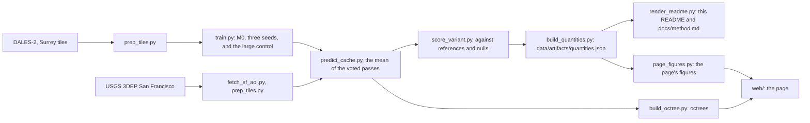

# surrey

A point cloud segmentation model trained on lidar flown over Surrey, British Columbia, run on San Francisco and scored there against references that owe nothing to it.

[](https://github.com/markolivaic/surrey/actions/workflows/ci.yml)


The colours are the model's predictions, not measurements. Left, the published model; right, the old four channel model with the input fault described below.

On held-out Surrey the published model reaches a point accuracy of 0.93. On San Francisco, a city it never saw, it finds 0.97 of the vegetation the aerial photograph shows in Golden Gate Park, but calls the delivery's water ground (0.95 at Embarcadero), a class its training labels do not have. Buildings in the Financial District, the one area taller than any block the model learned from, score lower than in the other built areas on 3 of 3 seeds, though the footprints there could not be registered to the lidar. A half precision neighbour search, fixed in the last round, had the older model call 0.95 of the Financial District's points more than 150 m up pole; with the search exact, 0.84 are called building, while elsewhere 8 of 69 figures moved, about as many as chance moves.

## What this is

- A PointNet++ style network trained on DALES-2 (Bendjilali and others, 2026), aerial lidar in fifteen classes flown over Surrey, British Columbia, not over Dayton.
- Run on eight areas of the USGS 3DEP San Francisco delivery and scored against the delivery's ground class, building footprints and NAIP vegetation, each beside its null.
- Three training seeds: the median, with the lowest and highest seed in brackets where they differ.
- A static web page that streams the real points, with a divider between the aerial photograph and the model's classes.

## What this is NOT

- **Not ground truth.** The colours on San Francisco are predictions, not part of any USGS deliverable.
- **Not a labelled benchmark.** None exists for this delivery: ground is scored against a vendor's automated class, buildings against 2D footprints, vegetation against an NDVI mask.
- **Not an untouched test.** San Francisco was also the development set; both faults below were found from its figures.
- **Not a model that knows water or bridges.** The training labels have no word for either.
- **Not the full page from a fresh clone.** A clone shows the page on a synthetic octree, labelled FIXTURE on screen.
- **Not new.** Cross-city loss in aerial lidar is known (Xie and others, 2021), DALES has been a source domain before (Wang and others, 2024), and softmax confidence is a weak signal for unfamiliar inputs (Hendrycks and Gimpel, 2017). This measures one case.

## The models

| Name | What it is | Read against |
|---|---|---|
| M0 | The published recipe: three inputs (x, y and height above the block floor), DALES-2 alone, seeds A, B and C; seed A is the published model | its nulls |
| Phase 4 M0 | The same recipe trained before the neighbour search was fixed | M0 only, to measure the fix |
| First round | The models trained before Phase 4: the four channel model, M0prime and M1, all with the old neighbour search | each only against itself or its pair |
| M0prime, M1 | First round models with Swiss tiles added; M0prime ignores Swiss water and bridge deck, M1 learns them as classes | each other |

Lift is (p - p0) / (1 - p0), where p is the model's precision against the footprints and p0 that of the null, which calls every point more than 2 m up a building; it is not given where the null calls nothing a building. A figure moved only when every seed of one model lies beyond every seed of the other, which chance alone does with probability 0.10 for three seeds a side ([docs/method.md](docs/method.md)). Each rented round was read by rules committed before its results: `docs/phase4_criteria.md`, `docs/phase6_criteria.md`.

## Walkthrough

[](docs/walkthrough/app-walkthrough.mp4)

One uninterrupted recording of the running page. No screen is mocked. Its first frame is the [poster](docs/walkthrough/app-walkthrough-poster.jpg).

## At home, on held-out Surrey

On the 11 held-out Surrey tiles, M0 reaches a point accuracy of 0.93, against 0.48 for calling everything ground. Mean IoU is 0.52 (0.52 to 0.53) over the fifteen classes and 0.81 over the six coarse groups the page draws. The rare classes carry the mean down:

| Class | Drawn as | Share of held-out points | IoU, M0 | IoU, Phase 4 M0, fp16 search | Moved |
|---|---|---|---|---|---|
| ground | ground | 0.48 | 0.93 (0.92 to 0.93) | 0.93 | did not move |
| vegetation | vegetation | 0.060 | 0.47 | 0.47 | did not move |
| car | vehicle | 0.0063 | 0.60 (0.60 to 0.61) | 0.60 (0.60 to 0.62) | did not move |
| powerline | pole | 0.0019 | 0.86 (0.86 to 0.88) | 0.87 (0.86 to 0.88) | did not move |
| fence | fence | 0.0049 | 0.43 (0.43 to 0.44) | 0.43 (0.43 to 0.44) | did not move |
| tree | vegetation | 0.28 | 0.90 | 0.90 | did not move |
| pickup | vehicle | 0.0010 | 0.22 (0.22 to 0.23) | 0.21 (0.20 to 0.23) | did not move |
| van-truck | vehicle | 0.0011 | 0.27 (0.26 to 0.28) | 0.27 (0.25 to 0.29) | did not move |
| heavy-duty | vehicle | 0.00024 | 0.060 (0.030 to 0.066) | 0.025 (0.021 to 0.048) | did not move |
| utility-pole | pole | 0.00029 | 0.20 (0.15 to 0.20) | 0.20 (0.19 to 0.22) | did not move |
| light-pole | pole | 0.00015 | 0.15 (0.14 to 0.17) | 0.17 (0.15 to 0.18) | did not move |
| traffic-pole | pole | 0.000069 | 0.23 (0.22 to 0.24) | 0.26 (0.22 to 0.26) | did not move |
| habitat | building | 0.12 | 0.88 (0.87 to 0.88) | 0.87 | did not move |
| complex | building | 0.042 | 0.64 (0.62 to 0.64) | 0.64 (0.63 to 0.64) | did not move |
| annex | building | 0.0051 | 0.41 (0.39 to 0.42) | 0.41 (0.41 to 0.42) | did not move |

KPConv's 0.811 on the original DALES (Varney and others, 2020) is over eight classes of another annotation and ranks nothing here. From `python scripts/pipeline/aggregate_seeds.py --recipe m0` (and `--recipe m0phase4`).

## San Francisco

Each class beside the figure that catches the opposite mistake, from `score_variant.py --variant m0_seedA` per seed and `aggregate_seeds.py --recipe m0`:

| Area | NAIP vegetation cores called vegetation | NAIP not-vegetation cores called vegetation | Delivery ground called ground | Ground precision, floor | Ground precision, ceiling |
|---|---|---|---|---|---|
| Golden Gate Park | 0.97 (0.97 to 0.98) | 0.94 (0.93 to 0.95) † | 0.97 (0.93 to 0.98) | 0.75 (0.74 to 0.75) | 0.97 |
| Sunset | 0.95 (0.94 to 0.95) | 0.056 (0.054 to 0.056) | 0.97 (0.96 to 0.98) | 0.74 (0.74 to 0.75) | 0.96 |
| Mission | 0.98 (0.98 to 0.99) | 0.047 (0.046 to 0.050) | 0.98 (0.94 to 0.99) | 0.71 (0.68 to 0.72) | 0.87 (0.84 to 0.89) |
| Russian Hill | 0.93 (0.92 to 0.94) | 0.065 (0.064 to 0.074) | 0.92 (0.90 to 0.94) | 0.77 (0.75 to 0.77) | 0.95 (0.92 to 0.95) |
| SoMa | 0.99 | 0.028 (0.028 to 0.035) | 0.99 (0.98 to 1.00) | 0.69 (0.67 to 0.71) | 0.84 (0.81 to 0.86) |
| Financial District | 1.00 | 0.12 (0.12 to 0.13) | 0.99 (0.97 to 0.99) | 0.62 (0.59 to 0.63) | 0.86 (0.81 to 0.87) |
| Embarcadero | 1.00 | 0.059 (0.053 to 0.066) | 0.84 (0.80 to 0.86) | 0.17 | 0.27 (0.26 to 0.28) |
| Bay Bridge | no core | 0.042 (0.031 to 0.051) | no core | no core | no core |

† The not-vegetation core in Golden Gate Park returns like canopy, so NDVI probably misses trees there; not read (`backend/surrey/reference.py`).

Buildings, in the areas where the footprint null calls something a building:

| Area | Footprints scored | Offset measured here | Building lift | Precision against footprints | The null's precision | Footprint covered | The null's coverage |
|---|---|---|---|---|---|---|---|
| Sunset | 33 | yes | 0.67 | 0.85 | 0.54 | 0.99 | 0.99 |
| Mission | 56 | yes | 0.61 | 0.83 | 0.56 | 0.97 (0.97 to 0.98) | 0.99 |
| Russian Hill | 77 | yes | 0.55 (0.55 to 0.57) | 0.83 (0.83 to 0.84) | 0.62 | 0.98 | 0.99 |
| SoMa | 26 | no | 0.56 (0.55 to 0.56) | 0.85 (0.84 to 0.85) | 0.65 | 0.72 (0.72 to 0.73) | 0.75 |
| Financial District | 23 | no | 0.22 (0.20 to 0.22) | 0.75 (0.74 to 0.75) | 0.68 | 0.83 (0.81 to 0.83) | 0.85 |
| Embarcadero | 6 | no | 0.13 (0.12 to 0.14) | 0.31 (0.30 to 0.31) | 0.20 | 0.85 (0.84 to 0.86) | 0.87 |

Water is called ground, 0.95 (0.92 to 0.99) at Embarcadero, and the Bay Bridge deck building, 0.36 (0.24 to 0.52). On water at Embarcadero, confidence separates these mistakes from right ground less well than the same kind of mistake at home: AUROC 0.75 (0.68 to 0.75) against 0.94 (0.92 to 0.94), lower on 3 of 3 seeds.

## The towers, and the neighbour search

The neighbour search took its squared distances in half precision, so the higher a point stood above its block floor, the closer its neighbours came to a random pick: on the tallest Financial District blocks the Phase 4 model matched an exact pass on 0.13 of the points more than 100 m up. The search now runs in fp32 and M0 was trained again, nothing else changed ([docs/phase6_criteria.md](docs/phase6_criteria.md)).

Of the Financial District's 233,408 points more than 150 m above the ground surface, Phase 4 M0 called 0.95 (0.82 to 0.96) pole and 0.041 (0.039 to 0.17) building; M0 calls 0.84 (0.77 to 0.85) building. No reference is needed for that. Everywhere else the fix moved little: of 69 figures compared, at home and in San Francisco, 8 moved, where chance alone moves 6.90, so none is read on its own ([docs/method.md](docs/method.md)). From `scripts/investigations/precision_audit.py`, `scripts/investigations/high_points_class.py` and `compare_recipes.py --new m0 --old m0phase4`.

## The Financial District, the one area outside the range

Its median 40 m block spans 99.8 m of height, against 46.2 m at the 99th percentile of training blocks and at most 34.5 m in any other area. A rule written before the first training expected buildings to score lower here, and they do on 3 of 3 seeds, with the search exact: lift 0.22 (0.20 to 0.22) against 0.58 (0.58 to 0.59) in the other built areas, and 0.20 (0.19 to 0.21) with the height gate taken from the delivery's own ground. This is weaker than the tower shares: the footprints could not be registered to the lidar here, so its 23 footprints are placed by the offset measured in 3 other areas.

## The input that broke the first model

The first model read a fourth input, the return ratio. The return fields of DALES-2 as published on Hugging Face hold 0, so it was 0 on all 395,996,290 prepared DALES-2 points, and real on all but 3 of 43,938,643 San Francisco points. Given that input as delivered, the old model called the forest building (one checkpoint, one input changed, `score_variant.py --variant returns_ood` and `--variant ret0`):

| Area | Vegetation cores called vegetation, as delivered | the same, ratio set to 0 | Not-vegetation cores called vegetation, as delivered | the same, ratio set to 0 |
|---|---|---|---|---|
| Golden Gate Park | 0.00020 | 0.97 | 0 † | 0.87 † |
| Sunset | 0 | 0.95 | 0 | 0.037 |
| Mission | 0 | 0.98 | 0 | 0.034 |
| Russian Hill | 0 | 0.93 | 0 | 0.049 |
| SoMa | 0 | 0.99 | 0 | 0.036 |
| Financial District | 0 | 1.00 | 0.0012 | 0.12 |
| Embarcadero | 0 | 1.00 | 0 | 0.065 |

† As in the San Francisco table, not read.

The published model has three inputs; `tests/integrity/test_input_channels.py` fails any model with an input constant in its training data.

## Water, and the old M1

M1, the first round's attempt at water, was trained on Swiss tiles where 0.86 to 1.00 of the labelled water is synthetic fill, a flat sheet of points on a 25 cm grid. Its gain over the water null is positive on 0 of 3 seeds at Embarcadero and 0 of 3 at Bay Bridge, and it is not trained again. What it took from the fill is not settled: moving the fill off its grid changed one seed of three, and on both sides water lies at the floor of its block, where flat ground lies too ([docs/method.md](docs/method.md)). `compare_recipes.py --new m1 --old m0prime` writes `compare_m1_vs_m0prime.json`.

## A bigger model

A control with 11,505,423 parameters, trained with the exact search, beats the highest small seed in 0 of 6 areas with footprints, where the rule written beforehand asked for 4 ([docs/method.md](docs/method.md)). `build_quantities.py` reads it from the two models' scores.

## Why this exists

Most lidar segmentation results are reported on tiles from the same survey the model learned from. That tells you how well it learned one place. It does not tell you what happens when the same model is pointed at a city it has never seen, which is what anyone who wants to use it will do.

I wanted to see that gap on real data, not on a benchmark split. Surrey is where the labels are; San Francisco has a public national lidar delivery and no labels at all. So the question became how to measure a model where nothing is labelled, without fooling myself. Each class is scored against something the model never touched: the delivery's own ground class, building footprints, vegetation from aerial imagery. Each figure stands beside a null, and the rules for reading it were written before the numbers.

This would be wrong if the references are wrong, and they are imperfect: the footprints sit off the lidar, the vegetation mask is a colour index, and San Francisco is also where the input fault was found. Those limits are written down below, next to the numbers they affect.

## The name

Surrey, British Columbia, is where the lidar was flown; every picture is San Francisco. DALES, which DALES-2 re-annotates, is the Dayton Annotated LiDAR Earth Scan, named after the University of Dayton, where it was annotated, and not flown over Dayton either.

## How it works



Every figure in this README is a key in `data/artifacts/quantities.json`, which `python scripts/pipeline/build_quantities.py` builds from the committed artefacts; `python scripts/pipeline.py` prints every step that writes those, with its command.

| Path | What it holds |
|---|---|
| `backend/surrey/` | The model, the block cache, inference and voting, the metrics, the palette and its rules, the registry of every quantity (`quantities.py`) |
| `scripts/pipeline.py` | Every step from the public sources to this README and the page, in order, with what each reads and writes |
| `scripts/pipeline/`, `scripts/investigations/` | The steps, and the measurements that each answered one question |
| `data/artifacts/` | The committed artefacts every figure is read from; `quantities.json` is the registry over all of them |
| `docs/readme.template.md`, `docs/method.template.md` | This README and the method notes with each figure named by registry key |
| `web/` | The page: its own three.js loader for Potree 2 octrees, the eye-dome pass, the cards, the free view |
| `tests/unit/`, `tests/integrity/`, `tests/smoke/` | Behavioural tests, guards over documents and artefacts, and the built page in a real browser |
| `docs/phase4_criteria.md`, `docs/phase6_criteria.md` | The rules of the two rented rounds, each written before it ran |

## Quick start

A fresh clone runs the tests and shows the page on the FIXTURE octree, with no key or account. It needs
Python 3.12 (called `python3` on some Linux systems) and Node 24.

```bash
python -m venv .venv
source .venv/bin/activate        # Git Bash: source .venv/Scripts/activate   cmd: .venv\Scripts\activate
python -m pip install -r requirements.txt
python -m pytest tests/unit tests/integrity -q
cd web
npm ci
npm run build
cd ..
python -m playwright install chromium     # on Linux, add --with-deps for the system libraries
python -m pytest tests/smoke -q
python scripts/pipeline/serve_page.py
```

`serve_page.py` prints the fixture page, `index.html?fixture=1`, and the real page, which needs the
octrees the pipeline builds. The tests use the CPU build of torch 2.9.1; the models were trained with
torch 2.11 on NVIDIA cards, each recorded in its training artefact.

```bash
python scripts/pipeline.py              # the steps, with what each reads and writes
python scripts/pipeline.py --check      # which outputs are already on disk
python scripts/pipeline.py --run all    # all of it, in order; hours, and an NVIDIA card
```

PotreeConverter 2.1.3 and ffmpeg are looked for on PATH, or named in `.env.example`.

## Verification

Each row is a command a reader runs from the repository root. The results are what
`python scripts/pipeline/verify.py` printed in the working copy, on Windows 11, AMD64 Family 25 Model 68 Stepping 1, AuthenticAMD, NVIDIA GeForce RTX 3050 Laptop GPU, Python 3.12.1, on
2026-09-29. A test is counted once however many cases a parametrisation makes of it. In a
fresh clone two integrity tests skip, because the octrees and the prepared tiles they read are built
by the pipeline and not committed. One behavioural test, the neighbour search on a CUDA card, skips
wherever torch has no card, as here.

| Check | Command | Result |
|---|---|---|
| behavioural tests | `python -m pytest tests/unit -q` | 177 tests; cases 185 passed, 1 skipped |
| integrity tests | `python -m pytest tests/integrity -q` | 47 tests; cases 51 passed |
| README is generated | `python scripts/pipeline/render_readme.py --check` | passes |
| page figures | `python scripts/pipeline/page_figures.py` | passes |
| viewer tests | `npm test (in web/)` | 7 passed, 0 failed |
| viewer build | `npm run build (in web/)` | passes |
| page smoke test | `python -m pytest tests/smoke -q` | 1 test; cases 1 passed |

## Limitations and failure modes

- San Francisco was the development set as well as the test, and the order of rules and results before the first commit is self-reported.
- The footprints were registered to the lidar in 3 of the 6 areas with footprints; the rest take their offset. Embarcadero's building figures rest on 6 footprints, the Financial District's on 23.
- In Golden Gate Park false vegetation is not read (†), and its core holds 13,847 points.
- Neighbouring points are not independent, and the seed range is the only spread given; it is not a confidence interval.
- The four channel model, M0prime and M1 carry the old half precision search; each is read only against itself or its pair.

## References

These references motivate the design; they do not validate the numbers here.

- Varney, N., Asari, V. K., Graehling, Q. DALES: A Large-Scale Aerial LiDAR Data Set for Semantic Segmentation. CVPR Workshops, 2020. arXiv 2004.11985.
- Singer, N. M., Asari, V. K. DALES Objects: A Large Scale Benchmark Dataset for Instance Segmentation in Aerial Lidar. IEEE Access 9, 97495 to 97504, 2021. doi:10.1109/ACCESS.2021.3094127.
- Bendjilali, M., Peyran, C., Velumani, K., Mauri, A., Luminari, N., Alliez, P. DALES 2: A Renovated Aerial LiDAR Benchmark for 3D Scene Understanding. CVPR Workshops (USM3D), 2026. Data at huggingface.co/datasets/mbendjilali/DALES-2.
- Xie, Y., Schindler, K., Tian, J., Zhu, X. X. Exploring Cross-City Semantic Segmentation of ALS Point Clouds. ISPRS Archives XLIII-B2-2021, 247 to 254, 2021.
- Wang, P., Yao, W., Shao, J., He, Z. Test-time adaptation for geospatial point cloud semantic segmentation with distinct domain shifts. arXiv 2407.06043, 2024.
- Hendrycks, D., Gimpel, K. A Baseline for Detecting Misclassified and Out-of-Distribution Examples in Neural Networks. ICLR, 2017.
- Qi, C. R., Yi, L., Su, H., Guibas, L. J. PointNet++: Deep Hierarchical Feature Learning on Point Sets in a Metric Space. NeurIPS, 2017.
- ASPRS. LAS Specification 1.4 R15, 09 July 2019, Table 17, ASPRS Standard Point Classes.
- Boucheny, C. Visualisation scientifique de grands volumes de données : pour une approche perceptive. PhD thesis, Université Joseph Fourier, Grenoble, 2009. HAL tel-00438464. The source of eye-dome lighting.

## License

Code: MIT, in LICENSE. Model weights and predictions: CC BY-NC 4.0, in LICENSE_MODEL.md, because the labels' upstream DALES layer carries a non-commercial restriction. Data, the quoted class table and model inputs carry their own terms, in THIRD_PARTY_NOTICES.md.
