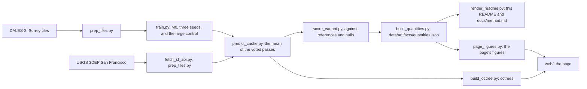

# surrey

A point cloud segmentation model trained on lidar flown over Surrey, British Columbia, run on San Francisco and scored there against references that owe nothing to it.

[](https://github.com/markolivaic/surrey/actions/workflows/ci.yml)


The colours are the model's predictions, not measurements. Left, the published model; right, the old model with the input fault described below.

## What this is

- A PointNet++ style network trained on DALES-2 (Bendjilali and others, 2026), a re-annotated aerial lidar benchmark in fifteen classes, flown over Surrey, British Columbia, Canada, not over Dayton.
- The published model, M0 seed A, run on eight areas of the USGS 3DEP San Francisco delivery and scored per area against the delivery's ground class, building footprints and NAIP vegetation, each beside its null.
- Three training seeds, every figure given as the median with the lowest and highest seed.
- A static web page that streams the real points, with a divider between the aerial photograph and the model's classes.

## What this is NOT

- **Not ground truth.** The colours on San Francisco are predictions of a model trained in another country, not measurements and not part of any USGS deliverable.
- **Not a labelled benchmark in San Francisco.** None exists for this delivery. Ground is scored against a vendor's automated class, buildings against 2D footprints of uncertain age, vegetation against an NDVI mask.
- **Not an untouched test.** San Francisco was also the development set: the input fault below was found from its figures.
- **Not a model that knows water or bridges.** The training labels have no word for either.
- **Not the full page from a fresh clone.** The real point clouds are built by the pipeline. A clone shows the page on a synthetic FIXTURE octree, labelled FIXTURE on screen.
- **Not new.** Airborne lidar segmentation losing accuracy from one city to another is known (Xie and others, 2021), DALES has been a source domain before (Wang and others, 2024), and softmax confidence is a known weak signal for unfamiliar inputs (Hendrycks and Gimpel, 2017). This is a careful measurement of one case, and a page to see it.

## Walkthrough

[](docs/walkthrough/app-walkthrough.mp4)

One uninterrupted recording of the running page: the first screen, the six cards, and the free view with the divider dragged across. Every state transition is rendered by the running application. No screen is mocked. Its first frame is the [poster](docs/walkthrough/app-walkthrough-poster.jpg).

## At home, on held-out Surrey

On the {{provenance.dales.test.tiles}} held-out Surrey tiles, M0 reaches a point accuracy of {{seeds.m0.surrey.test.accuracy_from_prediction_cache.median}} ({{seeds.m0.surrey.test.accuracy_from_prediction_cache.min}} to {{seeds.m0.surrey.test.accuracy_from_prediction_cache.max}}), against {{surrey.test.voxel.ground_fraction}} for calling everything ground. Mean IoU is {{seeds.m0.surrey.test.miou_15.median}} ({{seeds.m0.surrey.test.miou_15.min}} to {{seeds.m0.surrey.test.miou_15.max}}) over the fifteen classes and {{seeds.m0.surrey.test.miou_coarse.median}} ({{seeds.m0.surrey.test.miou_coarse.min}} to {{seeds.m0.surrey.test.miou_coarse.max}}) over the six coarse groups the page draws.

On the original DALES, KPConv reached a mean IoU of 0.811 (Varney and others, 2020), over eight classes of a different annotation; here the classes are fifteen and the points voxel-thinned, so the two numbers rank nothing.

## San Francisco

Median over three seeds, the lowest and highest in brackets, each class beside the figure that catches the opposite mistake.

{{table:sf_both_sides}}

Buildings, where the footprint null calls every point more than 2 m up a building. Lift is the share of the room above the null's precision that the model takes.

{{table:sf_buildings}}

Water is called ground, {{seeds.m0.sf.embarcadero.water_called_ground.median}} ({{seeds.m0.sf.embarcadero.water_called_ground.min}} to {{seeds.m0.sf.embarcadero.water_called_ground.max}}) at Embarcadero, and the Bay Bridge deck building, {{seeds.m0.sf.baybridge.bridge_deck_called_building.median}} ({{seeds.m0.sf.baybridge.bridge_deck_called_building.min}} to {{seeds.m0.sf.baybridge.bridge_deck_called_building.max}}). Confidence separates these mistakes from right ground less well than mistakes at home, AUROC {{seeds.m0.claims.hard_water_auroc.median}} against {{seeds.m0.claims.hard_home_auroc.median}}, on {{seeds.m0.claims.hard_errors_home_vs_water.k}} of {{seeds.m0.claims.hard_errors_home_vs_water.n}} seeds.

## Why the building lift moved

Against the first round, the building lift fell in the Mission, on Russian Hill, in SoMa and in the Financial District, where the retrained model covers more of each footprint, less precisely: a trade, by a reading written beforehand. The new block iterator moved it, not the voting ([docs/method.md](docs/method.md)).

## The Financial District, the one area outside the range

An area lies outside what training showed when its median 40 m block spans more height than the training blocks' 99th percentile, {{confounds.training_p99.block_z_range_m}} m. The Financial District's spans {{confounds.financial.block_z_range_m.median}} m, no other area's more than {{confounds.ggpark.block_z_range_m.median}} m. Buildings were expected to score lower here, and do on {{seeds.m0.claims.extrapolation.k}} of {{seeds.m0.claims.extrapolation.n}} seeds, lift {{seeds.m0.claims.financial_lift.median}} ({{seeds.m0.claims.financial_lift.min}} to {{seeds.m0.claims.financial_lift.max}}) against {{seeds.m0.claims.other_built_median_lift.median}} ({{seeds.m0.claims.other_built_median_lift.min}} to {{seeds.m0.claims.other_built_median_lift.max}}).

## The input that broke the first model

The first model read a fourth input, the return ratio. The return fields of DALES-2 as published on Hugging Face hold 0, so it was 0 on all {{surrey.all.voxel.return_ratio_exactly_0}} prepared DALES-2 points, and real on all but {{sf.aois.voxel.return_ratio_exactly_0}} of {{sf.aois.voxel.points}} San Francisco points. Given that input as delivered, the old model called the forest building:

{{table:bug}}

The published model has three inputs; `tests/integrity/test_input_channels.py` fails any model with an input constant in its training data.

## Water, and the old M1

M1, the first round's attempt at water, learned it from Swiss tiles where {{flags.swiss_training.water.synthetic.min}} to {{flags.swiss_training.water.synthetic.max}} of the labelled water is synthetic fill. Real water there holds at most a median of {{realwater.zurich2683_1246.source.density_median}} points per square metre, against {{realwater.embarcadero.source.density_median}} at Embarcadero. Its lift over the water null is negative on every seed, and it is not trained again ([docs/method.md](docs/method.md)).

## A bigger model

A control with {{train.m0_big_seedA.parameters}} parameters beats the highest small seed in {{capacity.areas_big_above_small_max}} of {{capacity.areas_with_footprints}} areas with footprints, where the rule written beforehand asked for 4 ([docs/method.md](docs/method.md)).

## Reading the figures

A figure moved only when every seed of one model lies beyond every seed of the other ([docs/method.md](docs/method.md) gives how often chance does that). Before the first commit, the order of rules and results is self-reported; from the first commit on, the git history shows it.

## Why this exists

Most lidar segmentation results are reported on tiles from the same survey the model learned from. That tells you how well it learned one place. It does not tell you what happens when the same model is pointed at a city it has never seen, which is what anyone who wants to use it will do.

I wanted to see that gap on real data, not on a benchmark split. Surrey is where the labels are; San Francisco has a public national lidar delivery and no labels at all. So the question became how to measure a model where nothing is labelled, without fooling myself. Each class is scored against something the model never touched: the delivery's own ground class, building footprints, vegetation from aerial imagery. Each figure stands beside a null, and the rules for reading it were written before the numbers.

This would be wrong if the references are wrong, and they are imperfect: the footprints sit off the lidar, the vegetation mask is a colour index, and San Francisco is also where the input fault was found. Those limits are written down below, next to the numbers they affect.

## The name

Surrey, British Columbia, is where the lidar was flown; every picture is San Francisco. DALES, which DALES-2 re-annotates, is the Dayton Annotated LiDAR Earth Scan, named after the University of Dayton, where it was annotated, and not flown over Dayton either.

## How it works



| Path | What it holds |
|---|---|
| `backend/surrey/` | The model, the block cache, inference and voting, the metrics, the palette and its rules, the registry of every quantity (`quantities.py`) |
| `scripts/pipeline.py` | Every step from the public sources to this README and the page, in order, with what each reads and writes |
| `scripts/pipeline/`, `scripts/investigations/` | The steps, and the measurements that each answered one question |
| `data/artifacts/` | The committed artefacts every figure is read from; `quantities.json` is the registry over all of them |
| `docs/readme.template.md`, `docs/method.template.md` | This README and the method notes with each figure named by registry key |
| `web/` | The page: its own three.js loader for Potree 2 octrees, the eye-dome pass, the cards, the free view |
| `tests/unit/`, `tests/integrity/`, `tests/smoke/` | Behavioural tests, guards over documents and artefacts, and the built page in a real browser |
| `docs/phase4_criteria.md` | The retraining's rules, written before it ran |

## Quick start

A fresh clone runs the tests and shows the page on the FIXTURE octree, with no key or account. It needs
Python 3.12 and Node 24.

```bash
python -m venv .venv
# Windows: .venv\Scripts\activate      Linux and macOS: source .venv/bin/activate
python -m pip install -r requirements.txt
python -m pytest tests/unit tests/integrity -q
cd web
npm ci
npm run build
cd ..
python -m playwright install chromium
python -m pytest tests/smoke -q
python scripts/pipeline/serve_page.py
```

`serve_page.py` prints the fixture page, `index.html?fixture=1`, and the real page, which needs the
octrees the pipeline builds. The tests use the CPU build of torch 2.9.1; the models were trained with
torch 2.11 on NVIDIA cards, each recorded in its training artefact.

```bash
python scripts/pipeline.py              # the steps, with what each reads and writes
python scripts/pipeline.py --check      # which outputs are already on disk
python scripts/pipeline.py --run all    # all of it, in order; hours, and an NVIDIA card
```

PotreeConverter 2.1.3 and ffmpeg are looked for on PATH, or named in `.env.example`.

## Verification

Each row is a command a reader runs from the repository root. The results are what
`python scripts/pipeline/verify.py` printed in the working copy, on {{verification.machine}}, on
{{verification.date}}. A test is counted once however many cases a parametrisation makes of it.

{{table:verification}}

## Limitations and failure modes

- San Francisco was the development set as well as the test.
- The footprints sit about two metres off the lidar; part of the offset is not explained.
- In Golden Gate Park the park's false vegetation figure rests on only {{notveg.sf.ggpark.points}} points.
- The old four channel model, M0prime and M1 are from the first round and appear only on the bug and water cards.
- Frame rates were measured on one laptop.

## References

These references motivate the design; they do not validate the numbers here.

- Varney, N., Asari, V. K., Graehling, Q. DALES: A Large-Scale Aerial LiDAR Data Set for Semantic Segmentation. CVPR Workshops, 2020. arXiv 2004.11985.
- Singer, N. M., Asari, V. K. DALES Objects: A Large Scale Benchmark Dataset for Instance Segmentation in Aerial Lidar. IEEE Access 9, 97495 to 97504, 2021.
- Bendjilali, M., Peyran, C., Velumani, K., Mauri, A., Luminari, N., Alliez, P. DALES 2: A Renovated Aerial LiDAR Benchmark for 3D Scene Understanding. CVPR Workshops (USM3D), 2026.
- Xie, Y., Schindler, K., Tian, J., Zhu, X. X. Exploring Cross-City Semantic Segmentation of ALS Point Clouds. ISPRS Archives XLIII-B2-2021, 247 to 254, 2021.
- Wang, P., Yao, W., Shao, J., He, Z. Test-time adaptation for geospatial point cloud semantic segmentation with distinct domain shifts. arXiv 2407.06043, 2024.
- Hendrycks, D., Gimpel, K. A Baseline for Detecting Misclassified and Out-of-Distribution Examples in Neural Networks. ICLR, 2017.
- Qi, C. R., Yi, L., Su, H., Guibas, L. J. PointNet++: Deep Hierarchical Feature Learning on Point Sets in a Metric Space. NeurIPS, 2017.
- ASPRS. LAS Specification 1.4 R15, 09 July 2019, Table 17, ASPRS Standard Point Classes.
- Boucheny, C. Interactive scientific visualization of large datasets: towards a perceptive-based approach. PhD thesis, Université Joseph Fourier, 2009. The source of eye-dome lighting.

## License

Code: MIT, in LICENSE. Model weights and predictions: CC BY-NC 4.0, in LICENSE_MODEL.md, because the labels' upstream DALES layer carries a non-commercial restriction. Data, the quoted class table and model inputs carry their own terms, in THIRD_PARTY_NOTICES.md.
